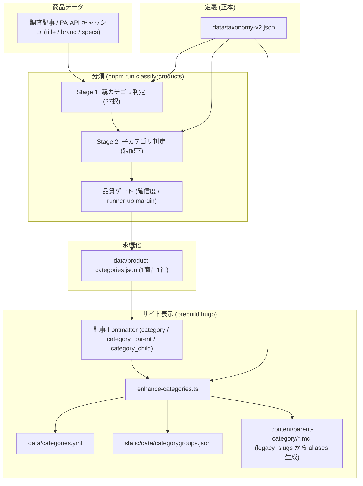

# カテゴリ管理・整理システム仕様書

本ドキュメントでは、本システムにおける商品カテゴリの階層構造、Gemini Decision 1 による自前タクソノミー分類、親カテゴリの命名規約、および Amazon カテゴリ正規化のトラブルシューティング手順を体系的に解説する。

---

## 1. カテゴリシステムの構造

本プラットフォームのカテゴリは、自前定義の **タクソノミー v2**（親27 × 子約250）を正本とする。商品ごとの所属は Gemini Decision 1（Decisions API）で判定し、結果を `data/product-categories.json` に永続化する。Amazon Creators API 由来のカテゴリ名は `amazon_category` として退避され、検索ヒットや再分類時の補助情報に用いる。



### 1.1 データソースファイル

| ファイル | 役割 | 管理形態 |
|---|---|:---:|
| `data/taxonomy-v2.json` | 親27・子カテゴリの定義（slug・日本語名・判定基準・`legacy_slugs`）。**正本** | 手動管理 |
| `data/product-categories.json` | ASIN ごとの分類結果（`category_parent` / `category_child` / `classification`）。1商品1行 | 自動生成（`classify:products`） |
| `data/legacy-category-map.json` | 旧 Amazon カテゴリ → 新カテゴリのフォールバック対応表（API 失敗・低確信度時に使用） | 手動管理 |
| `data/categories.yml` | 記事数集計やスラッグ等が付加されたHugo用カテゴリ階層データ | 自動生成（`prebuild:hugo`） |
| `static/data/categorygroups.json` | フロントエンドおよび Hugo テンプレート（`data/categorygroups.json` としてマウント）が参照するデータ | 自動生成（`prebuild:hugo`） |
| `content/parent-category/*.md` | 親カテゴリごとの一覧表示用Markdownページ（旧スラッグは `aliases` でリダイレクト） | 自動生成（`prebuild:hugo`） |

---

## 2. タクソノミー管理の必須規約

`data/taxonomy-v2.json` を編集（親・子の追加、名称変更、統合）する際は、サイトUIとURLの整合性を保つため以下のルールを遵守する。

### 2.1 命名規則と文字数制限

- **親カテゴリ名は14文字以内**（15文字以上は禁止）。ドロップダウン・ホーム画面での見切れ防止のためである。
- **子カテゴリ名は16文字以内**（カード・ピル表示の都合）。
- 各親は、判定の受け皿として `zz-` 接頭辞の「その他」子カテゴリを必ず持つ。
- これらは `src/category/taxonomy/__tests__/taxonomy-v2.test.ts` で検証される。

### 2.2 URL の後方互換（`legacy_slugs`）

親カテゴリの統合・改名で旧スラッグが消える場合は、統合先親の `legacy_slugs` に旧スラッグを必ず追加する。`prebuild:hugo` が `aliases: ["/parent-category/<旧スラッグ>/"]` を自動生成し、既存の被リンクが 404 にならない。旧31親カテゴリスラッグの全件が新 `slug` または `legacy_slugs` に含まれることはテスト（`taxonomy-v2.test.ts`）で保証される。

### 2.3 構文検証と事前ビルド同期

```bash
# 1. JSON構文・フォーマットのチェック
pnpm run biome:check

# 2. categories.yml / static/data/categorygroups.json / parent-category/*.md の自動同期
pnpm run prebuild:hugo
```

---

## 3. Gemini Decision 1 による商品分類ワークフロー

### 3.1 分類の流れ

1. **対象抽出**: `content/articles`・`data/investigations` の ASIN のうち、未分類のもの、および登録済みでも `classification.input_hash`（タイトル・ブランド・スペックのハッシュ）が現在の商品データと異なるもの（再調査で内容が更新された商品）を再分類対象とする。
2. **2段階判定**: 親（27択）→ 子（親配下）の順に Decisions API で判定する。確信度が閾値未満の場合は `needs_review: true` を付与し、必要に応じて `legacy-category-map.json` へフォールバックする。
3. **永続化**: 結果を `data/product-categories.json` に保存する。記事 frontmatter へは `category`（子カテゴリ日本語名）・`category_parent`・`category_child`・`classification` が反映され、旧 Amazon カテゴリ名は `amazon_category` に退避される。

### 3.2 主要コマンド

```bash
# 未分類・入力変更商品のみ分類（増分）
pnpm run classify:products

# ASIN を指定して分類（カンマ区切りで複数指定可）
pnpm run classify:products -- --asin B0XXXXXXXX,B0YYYYYYYY

# ドライラン（保存しない）／レート制御
pnpm run classify:products -- --dry-run --limit 20 --delay 500

# data/product-categories.json の内容を記事 frontmatter へ反映
pnpm run sync:product-categories -- --to-articles

# APIキーの登録・疎通検証
pnpm run set:gemini-key
pnpm run verify:gemini-key
```

### 3.3 CI での運用

- 新規商品の分類（`GEMINI_API_KEY` を使用）と `data/product-categories.json` のコミットは `deploy-articles.yml` に一本化している。
- `pr-auto-merge.yml` は読み取り専用権限のため分類 API を呼ばず、既存ストアに基づいて記事生成を検証する。
- 旧日次ワークフロー `organize-categories.yml`（Antigravity CLI によるカテゴリ整理）は廃止済みである。

### 3.4 SEO 上の扱い

- 商品数が `minCategoryProducts`（現在 10）未満の子カテゴリページは `noindex` とする。
- 検索意図が曖昧な「その他」受け皿（親 `others`、子「その他〜」「未分類・全般」）は商品数に関わらず `noindex` とする。

---

## 4. Amazon カテゴリ正規化エンジン（`CategoryNormalizer.ts`）

> [!NOTE]
> 本章の正規化エンジンは Amazon 由来のカテゴリ名（`amazon_category`）を決定するためのものである。サイト上の表示カテゴリは第3章の自前タクソノミー分類が決定する。

Amazon Creators API は、商品に対して複数のカテゴリ階層（BrowseNodes）を返却する。本システムの `src/utils/CategoryNormalizer.ts` は、その中から最も適切で具体的なカテゴリ名を1つ選出する。

### 4.1 選定アルゴリズムの優先順位ポリシー

最適なカテゴリは、以下の優先順位に従って厳格に決定される：

```text
1. カテゴリ階層の深さ (Depth / nameCount) 【最優先】
   └ 最も具体的（深い）な末端ノードを最優先する。
      (例: 「家電」よりも「生活家電 > 掃除機 > ロボット掃除機」を優先)

2. キーワードスコア (Score)
   └ 深さが同等の場合、preferredKeywords（家電、ベビー、玩具等）に合致するドメインを優先。

3. 売上順位 (SalesRank)
   └ 深さもスコアも同等の場合、Amazon上での売上順位が高いノードを優先。
```

### 4.2 モジュール構成と責務

カテゴリ正規化エンジンは、保守性と拡張性を高めるため以下の責務別モジュールに分離されている：

| モジュール | ファイル | 役割 |
|---|---|---|
| **統括ファサード** | `src/utils/CategoryNormalizer.ts` | 階層ツリー探索、ノード比較、スコア算出、最適カテゴリ選定の統括 |
| **定数・パターン定義** | `src/utils/category/CategoryConstants.ts` | 優先キーワード、除外正規表現、ブラックリスト（Set）、ホワイトリスト |
| **妥当性検証・ガード** | `src/utils/category/CategoryValidator.ts` | カテゴリ名検証、タイトル整合性ガード（スマホ、靴、猫トイレ等） |
| **サニタイズ・詳細化** | `src/utils/category/CategorySanitizer.ts` | 特殊記号除去、テレビ・コントローラー・バイク等の詳細化ルール |

### 4.3 ジャンクカテゴリの除外フィルタ設計

Creators API のレスポンスには、キャンペーン用や社内管理用の不要なノードが混入することがある。これらは `CategoryConstants.ts` および `CategoryValidator.ts` で除外される。

- **`BLACKLIST_CATEGORIES_SET`（完全一致除外・O(1)照合）**:
  - `パントリー`, `定期おトク便`, `タイムセール` 等のサービス名・企画名。
- **`INVALID_PATTERNS`（正規表現による除外）**:
  - キャンペーン・動的文字列: `/hpcafc\d*under/i`, `/^hpc/i`
  - ブランド名混入ノード: 特定ブランドの特設ストア用ノード
  - 記号・無効文字: スラッシュ連続や記号混入
- **タイトル整合性ガード（`CategoryValidator.ts`）**:
  - タイトル内に該当商品ジャンル（スマホ、シューズ、ペット用品など）のキーワードが存在しない場合の誤爆防止フィルタ。

---

## 5. 手動修正とトラブルシューティング

特定の商品が意図しないカテゴリ（「その他」やジャンクカテゴリ）に分類されている場合の調査・修正手順である。

> [!NOTE]
> AIエージェントおよび開発者向けの実践的なステップバイステップ手順は、[.agent/workflows/category-management.md](../.agent/workflows/category-management.md) にもまとめられている。

### 5.1 原因調査ステップ

1. **キャッシュ内の該当カテゴリ確認**:
   ```bash
   # キャッシュ内のカテゴリ表記を検索
   grep "対象キーワード" data/cache/paapi-product-cache.json
   ```

2. **Amazon API 生データの取得**:
   ```bash
   uv run python scripts/debug_dump.py <ASIN>
   ```
   実行後、`tmp/debug_output.json` に出力される生 BrowseNode 情報を確認する。

3. **正規化プロセスの詳細トレース**:
   ```bash
   npx ts-node tmp/repro_issue.ts <ASIN>
   ```
   各ノードの `Depth`, `Score`, `SalesRank` の競合状態をログで確認する。

### 5.2 テスト駆動によるロジック修正 (TDD)

1. **テストケースの追加**:
   `src/utils/CategoryNormalizer.test.ts` に不適切なカテゴリが `false` を返すテストを追加する。
   ```typescript
   it('should return false for junk category', () => {
     expect(CategoryNormalizer.isValidCategoryName('ジャンクカテゴリ名')).toBe(false);
   });
   ```

2. **ロジックの修正**:
   目的に応じて以下のファイルを更新する：
   - **完全一致での除外**: `src/utils/category/CategoryConstants.ts` の `BLACKLIST_CATEGORIES_SET` に追加。
   - **正規表現・パターンでの除外**: `src/utils/category/CategoryConstants.ts` の `INVALID_PATTERNS` に追加。
   - **特定ドメインの優先**: `src/utils/category/CategoryConstants.ts` の `PREFERRED_KEYWORDS` または `HIGH_PRIORITY_KEYWORDS` に追加。
   - **タイトル連動の誤爆防止ガード**: `src/utils/category/CategoryValidator.ts` のガード条件を更新。
   - **カテゴリ名の詳細化・置換**: `src/utils/category/CategorySanitizer.ts` の解決ルールを更新。

3. **テスト実行**:
   ```bash
   pnpm test src/utils/CategoryNormalizer.test.ts
   ```

### 5.3 キャッシュのリセットと再生成

ロジックを修正した後は、既存のAPIキャッシュをリセットして再取得させる必要がある。

- **キーワード指定による一括リセット**:
  ```bash
  pnpm run reset:category-cache -- "リセット対象のカテゴリ名"
  # または: npx tsx src/scripts/maintenance/reset-category-cache.ts "リセット対象のカテゴリ名"
  ```
- **ASIN指定による個別リセット**:
  ```bash
  pnpm run reset:cache-timestamp -- <ASIN>
  # または: npx tsx src/scripts/maintenance/reset-cache-timestamp.ts <ASIN>
  ```
- **記事の再生成と反映確認**:
  ```bash
  pnpm run generate:articles -- --asin <ASIN>
  ```
  `content/articles/<ASIN>.md` のフロントマター（`categories`, `subcategory`）が正しく修正されているか確認する。

---

## 6. カテゴリ関連コマンド一覧

| コマンド | 役割 |
|---|---|
| `pnpm run classify:products` | Gemini Decision 1 により未分類・更新商品を新タクソノミーへ自動分類する |
| `pnpm run sync:product-categories` | `data/product-categories.json` の分類結果を記事 Markdown の frontmatter に同期する |
| `pnpm run prebuild:hugo` | カテゴリ階層を拡張し、`categories.yml` や親カテゴリMarkdownを同期する |
| `pnpm run biome:check` | `data/taxonomy-v2.json` を含む定義JSONの構文妥当性を検証する |
| `pnpm run reset:category-cache -- "<ワード>"` | 指定したカテゴリ名を含む商品のキャッシュタイムスタンプをリセットする |
